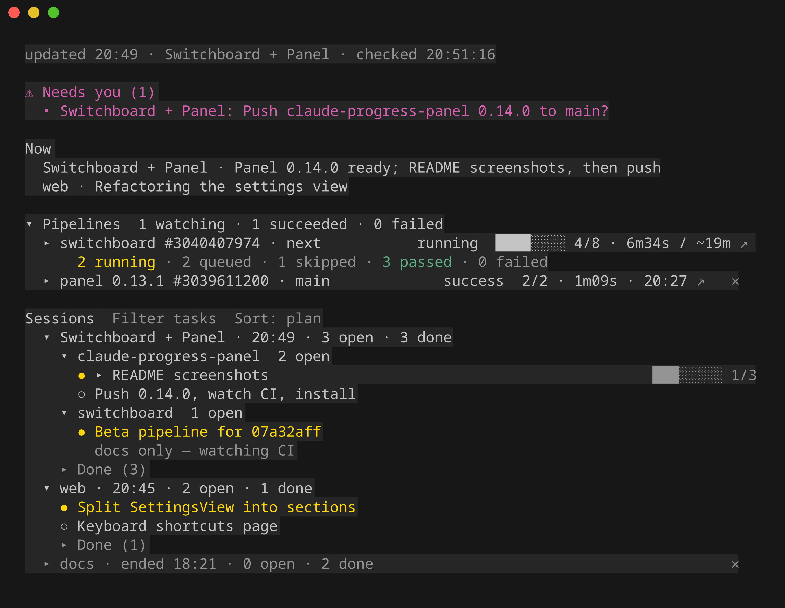

# Claude Code progress panel

A pane beside every Claude Code chat on your machine that shows what **every session** is doing —
the newest update, what **needs you** (from any session, highlighted), one **now** line per
session, and each session's tasks grouped and foldable, with a Done list you can clear.



It is a Claude Code plugin: a hooks module that draws the pane and gives the agent a
`progress_update` tool, plus a skill that teaches the agent when to call it. Your sessions' status
never leaves your machine: they share a local folder. The plugin's only network call of its own is
the update check (below); pipelines are read by your own `glab` / `gh` / `tea` / command.

> **A personal tool, shared as is.** I built it for how I work — several sessions at once, in a
> wide terminal, waiting on CI — and publish it in case it helps someone else. Best effort: issues
> and merge requests are welcome on
> [GitLab](https://gitlab.com/KirboDev/agentic-coding/claude-progress-panel/-/issues), but there are
> no promises of support or of keeping up with every Claude Code change. Worth knowing before you
> install: it asks every session to keep its entry current, which costs a few tokens and a tool
> call every few steps; it needs a recent Claude Code; and the pane wants a wide terminal.

## Install

Needs Claude Code **2.1.318 or newer**.

In a terminal (any directory):

```sh
claude plugin marketplace add https://gitlab.com/KirboDev/agentic-coding/claude-progress-panel.git
claude plugin install progress-panel@claude-progress-panel --scope user
```

(The [GitHub mirror](https://github.com/Kirbo/claude-progress-panel) works too:
`claude plugin marketplace add Kirbo/claude-progress-panel`. GitLab is where it is developed and
where the release notes live.)

Or inside a Claude Code session:

```
/plugin install progress-panel --marketplace https://gitlab.com/KirboDev/agentic-coding/claude-progress-panel.git
```

answer `y` to add the marketplace and pick the **user** scope. New sessions load it from then on.

**Update:** `claude plugin update progress-panel@claude-progress-panel`, then `/reload-plugins` in
a running session. **Remove:** `claude plugin uninstall progress-panel@claude-progress-panel`.

## Use

- The pane opens by itself when a session starts in a terminal at least ~144 columns wide; on a
  narrower one (or after closing it) type **`/progress`**. In a fullscreen terminal from 110 columns
  it docks beside the chat as a sidebar — drag its edge (or resize it with the keyboard) and Claude
  Code keeps that width; on a narrower one it sits full width above the prompt, its height likewise
  draggable. Its starting size comes from the settings below.
- **Every session reports on its own.** The plugin adds a short rule to each session's system
  prompt (a session already running when you install or reload the plugin gets it with its next
  prompt, plus a one-line reminder until it first reports): on any task with more than one step the agent's first call sets `now` and the task
  list, **in the order it will do them**; it moves each task as it goes, gives a task its
  subtasks (`steps`) and a longer `detail` when it has parts, tags tasks with their `repo` when it
  works in several, puts every decision only you can make in **Needs you**, and watches every push
  to a repo with CI. Nothing to add to your `CLAUDE.md`; the bundled `progress-panel` skill has the
  details.
- **Sessions** are named as Claude Code names them: a `/rename` shows from your next prompt on
  (else the repo or folder name).
- **Tasks:** listed in plan order by default — the order the agent will do them (it reshuffles
  with `order`). A task with subtasks or a detail is a fold: its title shows `██░░ n/m` of its steps
  done, and a press opens the detail and each step — a task in progress with steps starts open, so
  you see what it is on without a click (fold it and it stays folded). Once a session's open tasks span several repos
  they group under one foldable heading per repo (one repo: no heading); its Done list does the
  same on its own.
- **Subagents report too:** a subagent's `progress_update` lands under its coordinator's session,
  in an **Agents** part — never among the session's tasks. Each running agent shows its steps
  (`██░░ 3/7`), how long it has run and `~N min left`, and unfolds to what it is on and every step
  with its status and note (a step's own estimate, e.g. `~10 min`). A finished agent moves under the
  session's **Done**, in its own folded **Agents** heading, and stays — nothing is cleaned up
  automatically. An open Done lists the newest 10 finished tasks (and 5 finished agents); older
  ones fold behind **N older**, so a long day's history never pushes the live work out of view. A subagent that cannot report (one without the tool, such as a read-only
  reviewer) still shows there by its task description while it runs. The coordinator sees its
  running subagents in every `progress_update` answer.
- **Remove a task** with the `✕` on its row: every pane hides it at once, its session marks it
  skipped ("removed in the Progress pane") and tells its agent right after its next step — "do not
  do it; stop if you are on it". Works for any live session's tasks, not only this one's.
- **Sort** cycles plan → status → title → created → done (remembered). **Filter tasks** beside it
  keeps only the tasks whose title, note, detail or steps hold what you type, the matching text
  highlighted (a task whose hit is in its detail or steps unfolds by itself); sessions without a
  match step aside.
- Every `▾`/`▸` line folds. **✕** removes a done task (or an ended session); **Clear all** (shown
  while its Done list is open) empties the list.
- **Version and updates:** the pane's top-right corner shows the version it runs; when a newer
  release exists it adds `vX.Y.Z available ↗`, linking that release's notes. The newest release is
  looked up from this repository's GitLab Releases at most every 6 h, shared by every session on
  the machine; `CLAUDE_CODE_DISABLE_NONESSENTIAL_TRAFFIC=1` turns the check off.
- **Closed the pane?** `/progress` in any session opens it again.
- **Something not working?** `/progress doctor` checks this session's setup, one line per check
  with its fix: the plugin version, whether this session got the reporting rule, the progress
  folder, the repo's CI, the forge CLI for it (installed, logged in for the host, able to read
  this project — one API call through your own `glab` / `gh` / `tea`) and whether git reaches the
  remote (an untrusted SSH host key, missing credentials). Read-only.
- **In the transcript** a `progress_update` call is one quiet line (`◦ Progress · <now> · 2 tasks`);
  ctrl+o shows it in full.

### Pipelines

**Every `git push` the agent runs is watched automatically** — no tool call: when the push lands,
the plugin reads the repo's CI off its files (`.gitlab-ci.yml` → GitLab, `.github/workflows/` →
GitHub Actions, `.gitea/` or `.forgejo/workflows/` → Gitea/Forgejo, else your **Custom CI command**),
the forge's host and project off the pushed remote (ssh or https, self-hosted included) and the
pushed commit's sha, and watches that run. A push that fails, is rejected, is a dry run or deletes a
branch watches nothing; a repo without CI neither, nor a push to a mirror on another kind of forge
(a GitLab-CI repo pushed to its GitHub mirror). It reads `cd`/`pushd` (Windows' `cd /d` and drive
paths too), `git -C` and `git.exe`; a push through a git alias or a wrapper script it cannot see —
there the agent's own `watch` (the rule) still covers it. The agent still `watch`es a CI run by id, or by
commit sha (whole or abbreviated) before the run exists — another repo's, or a push made outside the
session — and the pane follows it
live: state, a progress bar of finished / all jobs while it runs, how long it has run (beside an
estimate from up to 5 earlier successful runs of the same branch and trigger, GitLab and GitHub),
and once finished the counts, the duration and the time it finished — all on the right of the
row, beside `↗` (open it in the browser) and `✕` (dismiss a finished one). A running pipeline
stands out — a yellow `●` (cyan `○` while queued), its name and state in bold, the section's
"N watching" lit — while a finished one dims to its outcome's colour. A press unfolds every
job, grouped by stage. The row under the pointer is highlighted. The section header sums up
every pipeline and folds itself once all succeeded; successes older than an hour move into a
folded "Finished" row.

| CI | `watch` | Needs, on PATH and logged in |
| --- | --- | --- |
| GitLab (gitlab.com or self-hosted) | `{ project: "group/name", pipeline \| sha }` | [`glab`](https://gitlab.com/gitlab-org/cli) |
| GitHub Actions (github.com or Enterprise) | `{ provider: "github", project: "owner/repo", run \| sha }` | [`gh`](https://cli.github.com) |
| Gitea / Forgejo Actions | `{ provider: "gitea", project: "owner/repo", run \| sha }` | [`tea`](https://gitea.com/gitea/tea), a login for that host |
| Anything else (Jenkins, Bitbucket, Azure DevOps, Woodpecker…) | `{ provider: "command", project: "<a name your command knows>", pipeline \| sha }` | your own command, set as **Custom CI command** |

- **Private repos work**: the plugin makes no API calls of its own; it runs your own `glab` / `gh`
  / `tea` with your login, so it sees what you can see.
- **Which host:** a watch of the session's own repo takes the host of its `origin` remote; any
  other gives `host` (e.g. `"git.example.com"`), else the forge's public one. Every call names its
  host, so it works the same from any directory.
- **Who polls:** the session that watches a run polls it every 15 s until it finishes (no forge
  can push to a local plugin). If that session ends or dies first, any open pane takes over after
  a minute.
- **Custom CI command:** the setting is a command line with placeholders `{project}`, `{id}`,
  `{sha}`, `{host}` (each filled inside its own argument; no shell; `~/` = your home), e.g.
  `~/bin/ci-status {project} {id}`. It must print the run as JSON — or nothing / `{}` while the run
  does not exist yet:

  ```json
  {
    "id": 12,
    "state": "running",
    "url": "https://ci.example.com/job/nightly/12",
    "ref": "main",
    "startedAt": "2026-11-07T10:00:00Z",
    "finishedAt": null,
    "durationS": null,
    "jobs": [{ "name": "build", "stage": "build", "state": "success", "durationS": 30, "url": "…" }]
  }
  ```

  States: `queued`, `running`, `success`, `failed`, `canceled`, `skipped`, `manual`. Only the
  setting chooses the command — an agent can never make the plugin run one.
- Pipelines need Claude Code's CLI host (the terminal, or an IDE extension running it): they
  refresh through `glab` / `gh` / `tea` / your command, which a surface without a local CLI (e.g.
  the mobile app) cannot run. The rest of the pane works everywhere.

### Settings

`/config` (or `claude plugin configure progress-panel`):

| Option                  | Values                                  | Default                |
| ----------------------- | --------------------------------------- | ---------------------- |
| `progressDir`           | a folder (`~/` allowed)                  | `~/.claude/progress`   |
| `autoClearDoneHours`    | 0 (never), 1, 3, 6, 12, 24, 48, 72, 168 | 0                      |
| `keepEndedSessionsDays` | 0 (never), 1, 3, 7, 14, 30              | 7                      |
| `sortTasksBy`           | plan, status, title, created, done      | plan                   |
| `ciCommand`             | a command line (see Pipelines)          | (off)                  |
| `paneColumns`           | sidebar width: 0 (Claude Code's), 48–110 | 84                     |
| `paneRows`              | height above the prompt: 0 (a third), 12–40 | 20                 |

The environment variable `PROGRESS_PANEL_DIR` overrides `progressDir` for one session (a demo
or test folder) without moving everyone else's.

### How it works

- Each session writes only its own file, `<progressDir>/<session-id>.json`, through the
  `progress_update` tool, one write at a time — nobody else writes it, so sessions never
  overwrite each other. Your ✕ / Clear all, and pipeline refreshes a pane made for a session that
  stopped polling, go to a separate `<session-id>.dismissed.json`, which the session folds in on
  its next update. A file caught half-written is ignored until the next refresh. The tool takes a
  patch (`now`, `needsYou`, `tasks` upserted by id or title — with `note`, `detail`, `steps`,
  `repo` — `remove`, `order`, `watch`, `unwatch`); the plugin stamps the times. Format:
  [`docs/design/MULTI-SESSION.md`](docs/design/MULTI-SESSION.md).
- Every pane lists the folder every 2 seconds and reads a file only when it changed (plugins have
  no file-watch API). A session's own update shows at once.
- The header carries two times: **updated** — the newest status change of any session — and
  **checked** — when this pane last looked. A check older than 10 s turns yellow with "(stale)".
- A session marks its entry ended when it closes; ended entries are dimmed and folded, and are
  removed after `keepEndedSessionsDays`. A session that never reported anything leaves nothing.

### Releases

Every version has a [GitLab Release](https://gitlab.com/KirboDev/agentic-coding/claude-progress-panel/-/releases)
with what changed in it.

## Develop

Toolchain via [mise](https://mise.jdx.dev) (`mise.toml` pins Biome and Claude Code; `mise.lock`
is committed):

```sh
mise install
mise exec -- biome check .                 # lint + format check (biome check --write . to fix)
mise exec -- claude plugin test .          # hooks/*.test.tsx against the engine
mise exec -- claude plugin validate .      # manifest + module, as the engine reads them
mise exec -- node --test scripts/          # sealing + audit-register guard tests
mise exec -- node scripts/check-audits.mjs # audit-register guard (also run by CI)
claude --plugin-dir .                      # a session with this working copy loaded
git config core.hooksPath .githooks        # once per clone: pre-commit runs Biome (fix + re-stage) and seals audit findings
```

Test-first: a change lands with its test (`hooks/*.test.ts` for the pure logic,
`hooks/register.test.tsx` for the plugin against the engine). Every user-facing string
lives in `locales/en.ts` and goes through `t()` (`hooks/i18n.ts`). CI (`.gitlab-ci.yml`) runs the
checks above on every push, and on `main` gives each new `version` in `.claude-plugin/plugin.json`
its GitLab Release, notes by [git-cliff](https://git-cliff.org) from the commit subjects
(`scripts/release.mjs`, `cliff.toml`). Security findings that are not fixed yet are never published: they are
age-sealed in `docs/audits/` (process: [`docs/audits/README.md`](docs/audits/README.md); `/audit`
and `/maintain` are project skills in `.claude/skills/`).

## License

[MIT](LICENSE)
